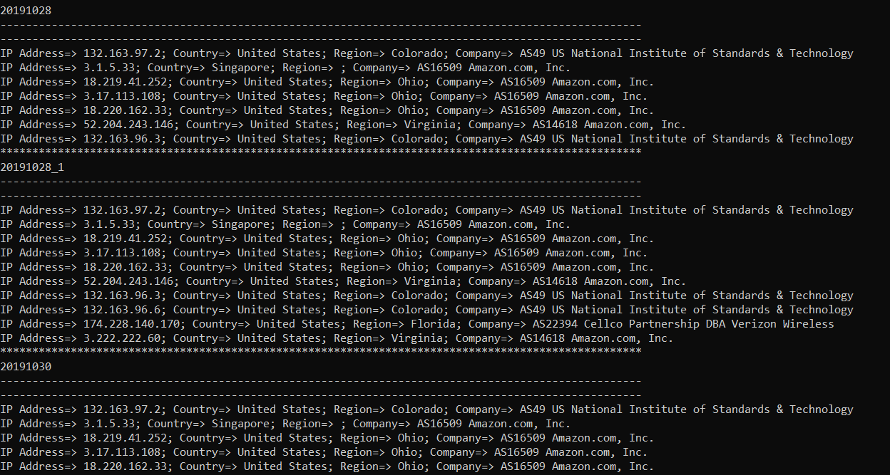
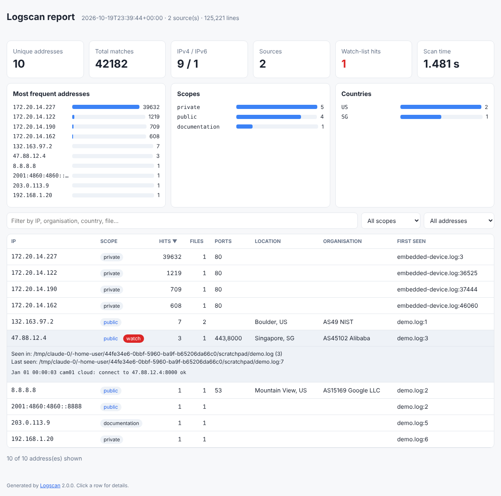

<div align="center">

# 🔎 Logscan

**Find, classify and enrich every IP address hidden in your log files.**

Point it at a firmware dump, a camera's debug log, a router's syslog or a whole directory of rotated `.gz` archives,
and Logscan tells you **which hosts on the Internet the device talks to**, how often, on which ports, where they
are and who owns them — as a terminal table, JSON, CSV, Markdown or an interactive HTML report.

[](https://github.com/essvega/Logscan/actions/workflows/ci.yml)


[](https://www.onedayact.com)

</div>

---

## Table of contents

- [Why Logscan](#why-logscan)
- [Features](#features)
- [Installation](#installation)
- [Quick start](#quick-start)
- [Usage](#usage)
  - [Inputs](#inputs)
  - [Filtering and scopes](#filtering-and-scopes)
  - [Watch lists and ignore lists](#watch-lists-and-ignore-lists)
  - [Enrichment (geolocation and ownership)](#enrichment-geolocation-and-ownership)
  - [Output formats](#output-formats)
  - [Exit codes](#exit-codes)
  - [Full option reference](#full-option-reference)
- [Interactive HTML report](#interactive-html-report)
- [Python API](#python-api)
- [How it works](#how-it-works)
- [Recipes](#recipes)
- [Development](#development)
- [Project layout](#project-layout)
- [Upgrading from 1.x (`read.py`)](#upgrading-from-1x-readpy)
- [Roadmap](#roadmap)

---

## Why Logscan

Embedded and IoT devices — IP cameras, DVRs, routers, smart plugs — rarely tell you who they phone home to. Their
logs do. Logscan was born to answer one question from a 9 MB camera log: *"which public servers is this thing
connecting to?"* Running it on the bundled sample:

```console
$ logscan examples/embedded-device.log
IP            SCOPE   HITS  FILES  PORTS  FIRST SEEN                WATCH
────────────  ──────  ────  ─────  ─────  ────────────────────────  ─────
132.163.97.2  public     6      1         embedded-device.log:4708

1 unique address(es) [1 IPv4 / 0 IPv6] from 42174 match(es) in 1 source(s), 125214 line(s), 1.4s
Filtered occurrences: private=42168  (use --scope all to include)
```

Out of 125,214 lines and 42,174 address mentions, exactly **one** public host is contacted: `132.163.97.2`, a NIST
time server (the device's NTP sync). Everything else is LAN traffic, which Logscan filters out for you.

## Features

| | |
|---|---|
| 🧠 **Accurate extraction** | Strict IPv4 (rejects `1.2.3.4.5` version strings, `01.2.3.4`, `256.x`), full IPv6 (compressed, bracketed `[v6]:port`, zone IDs `%eth0`, IPv4-mapped), ports captured from `ip:port`. Timestamps, MAC addresses, UUIDs and C++ `::` are not mistaken for addresses. |
| 🏷️ **Precise classification** | Eleven scopes based on the IANA special-purpose registries: `public`, `private`, `shared` (CGNAT), `loopback`, `link-local`, `multicast`, `documentation`, `benchmark`, `unspecified`, `broadcast`, `reserved` (bogons). Identical results on every Python version. |
| 📂 **Any input** | Files, whole directory trees, `-` for stdin, and transparent decompression of `.gz`, `.bz2`, `.xz`/`.lzma`. Binary files and VCS/virtualenv folders are skipped automatically; `--glob`/`--exclude` filters. Handles BOMs and invalid UTF-8. |
| 📊 **Aggregation** | Per address: hit count, files it appears in, ports used, first and last occurrence (`file:line`), and the first log line as a sample. |
| 🌍 **Enrichment** | Optional country / region / city / ASN / organisation / hostname / coordinates from [ipinfo.io](https://ipinfo.io) (HTTPS) or [ip-api.com](https://ip-api.com) (batch). Parallel lookups, retries with back-off, and an on-disk cache so you never pay for the same lookup twice. |
| 🚨 **Watch lists** | Flag addresses inside known-bad networks (`--watch @blocklist.txt`) and fail CI pipelines with `--fail-on-watch`. Silence noise with `--ignore`. |
| 🧾 **Six output formats** | Colour terminal table, JSON, NDJSON, CSV (spreadsheet-formula safe), Markdown, and a self-contained interactive HTML report. |
| 🪶 **Zero dependencies** | Pure Python standard library. Nothing to break, nothing to audit. |
| 📦 **Ships everywhere** | `pip`/`pipx`, Docker image, and standalone executables for Windows, macOS and Linux built on every release. |
| ✅ **Tested** | ~90 tests, >90 % coverage, CI on Linux/macOS/Windows × Python 3.9–3.13, lint (ruff) and type-checking (mypy). |

## Installation

Logscan needs **Python 3.9 or newer** and nothing else.

```bash
# Recommended: isolated install of the command-line tool
pipx install git+https://github.com/essvega/Logscan.git

# Or with pip, inside a virtual environment
python -m venv .venv
source .venv/bin/activate          # Windows: .venv\Scripts\activate
pip install git+https://github.com/essvega/Logscan.git

# Or from a clone
git clone https://github.com/essvega/Logscan.git
cd Logscan
pip install .
```

**No Python?** Download a standalone executable (`logscan-windows-x86_64.exe`, `logscan-macos-arm64`,
`logscan-linux-x86_64`) from the [Releases page](https://github.com/essvega/Logscan/releases).

**Docker:**

```bash
docker build -t logscan https://github.com/essvega/Logscan.git
docker run --rm -v "$PWD/logs:/logs:ro" logscan /logs
```

Check the installation with `logscan --version`. You can also run it as a module: `python -m logscan`.

## Quick start

```bash
logscan device.log                                  # public addresses in one file
logscan ./logs                                      # every text file in a directory tree
logscan ./logs --scope all                          # include private/LAN addresses too
logscan ./logs --enrich ipinfo                      # add country, city, ASN and organisation
logscan ./logs --enrich ipinfo -o report.html       # interactive HTML report
logscan ./logs -f json -o report.json               # machine-readable output
journalctl -o cat | logscan -                       # read from stdin
```

## Usage

```
logscan [OPTIONS] [PATH ...]
```

With no `PATH`, Logscan scans the current directory.

### Inputs

| Input | Behaviour |
|---|---|
| `file.log` | Scanned whatever its extension. |
| `file.log.gz`, `.bz2`, `.xz`, `.lzma` | Decompressed on the fly. |
| `directory/` | Walked recursively in a stable (sorted) order. Hidden directories, `.git`, `node_modules`, virtualenvs and files that look binary are skipped. |
| `-` | Standard input. |

```bash
logscan logs/ --glob '*.log' --glob '*.log.*'      # only these file names
logscan logs/ --exclude '*.bak'                     # skip these
logscan logs/ --no-recursive                        # top level only
logscan firmware/ --binary                          # also search binary files
```

The same file given twice (or reachable through two paths) is scanned once.

### Filtering and scopes

By default only **public** (globally routable) addresses are reported. Every other occurrence is counted and
summarised so nothing is silently lost. Choose scopes with `--scope` (repeatable):

| Scope | IPv4 | IPv6 |
|---|---|---|
| `public` | everything not listed below | `2000::/3` not listed below |
| `private` | `10/8`, `172.16/12`, `192.168/16` | `fc00::/7` (ULA) |
| `shared` | `100.64/10` (carrier-grade NAT) | – |
| `loopback` | `127/8` | `::1` |
| `link-local` | `169.254/16` | `fe80::/10` |
| `multicast` | `224/4` | `ff00::/8` |
| `documentation` | `192.0.2/24`, `198.51.100/24`, `203.0.113/24` | `2001:db8::/32`, `3fff::/20` |
| `benchmark` | `198.18/15` | – |
| `unspecified` | `0.0.0.0` | `::` |
| `broadcast` | `255.255.255.255` | – |
| `reserved` | `0/8`, `240/4`, `192.0.0/24`, … | `2001::/23`, `2002::/16`, other non-unicast space |

IPv4-mapped IPv6 addresses (`::ffff:a.b.c.d`) are classified by their IPv4 address.

```bash
logscan logs/ --scope private --scope shared        # LAN-side view
logscan logs/ --scope all                           # everything
logscan logs/ -4                                    # IPv4 only  (-6 for IPv6 only)
logscan logs/ --min-hits 10 --sort hits --top 20    # the 20 busiest talkers seen ≥ 10 times
```

Sort keys: `hits` (default), `ip`, `first-seen`, `files`.

### Watch lists and ignore lists

Both options take addresses, CIDR blocks, or `@file` (one entry per line, `#` comments allowed) and can be repeated:

```bash
logscan logs/ --ignore 8.8.8.8 --ignore 1.1.1.0/24          # never report these
logscan logs/ --watch @examples/watchlist.txt               # flag matches in the WATCH column
logscan logs/ --watch @blocklist.txt --fail-on-watch        # exit status 3 if any match
```

Watch-list hits are highlighted in red in the terminal, get a badge in the HTML report, and have a `watch` field
(the matching network) in JSON/CSV. This makes Logscan a drop-in gate for CI pipelines and firmware QA.

### Enrichment (geolocation and ownership)

Add `--enrich PROVIDER` to look up each **public** address:

| Provider | Transport | Key | Notes |
|---|---|---|---|
| `ipinfo` | HTTPS | optional — `--token` or `IPINFO_TOKEN` | Works without a token at a low rate limit. [Get a free token](https://ipinfo.io/signup). Parallel lookups (`--workers`, default 8). |
| `ip-api` | **HTTP only** (free tier) | none | 100 addresses per batch request. Non-commercial use; data travels unencrypted. |

```bash
export IPINFO_TOKEN=your_token        # Windows PowerShell: $env:IPINFO_TOKEN="your_token"
logscan logs/ --enrich ipinfo
```

Fields added: `country_code`/`country`, `region`, `city`, `asn`, `org`, `hostname`, `latitude`, `longitude`.

Results are cached in `~/.cache/logscan/enrich.json` (`$XDG_CACHE_HOME` and `%LOCALAPPDATA%` are honoured) for
7 days. Use `--cache FILE`, `--cache-ttl HOURS` or `--no-cache` to change that. Transient errors (HTTP 429/5xx,
timeouts) are retried with exponential back-off; a failed lookup is shown as such without aborting the scan, while
an invalid token stops with a clear message. HTTP(S) proxies from `HTTPS_PROXY`/`HTTP_PROXY` are used automatically.

> 🔒 Your token is sent in an `Authorization` header, never in the URL, and is never written to reports or the cache.

### Output formats

Pick one with `-f/--format`, or let Logscan infer it from the `-o/--output` extension
(`.json`, `.ndjson`/`.jsonl`, `.csv`, `.md`, `.html`, `.txt`).

| Format | Best for |
|---|---|
| `table` | Reading in a terminal. Coloured when stdout is a TTY (`--color always/never`, honours `NO_COLOR` / `FORCE_COLOR`). |
| `json` | Full report: tool version, timestamp, summary statistics, per-source stats, all addresses. |
| `ndjson` | One address per line — stream into `jq`, Elasticsearch, Splunk, Loki… |
| `csv` | Spreadsheets. Cells that could be interpreted as formulas are neutralised. |
| `markdown` | Pasting into issues, pull requests and wikis. |
| `html` | Sharing: a single self-contained, offline, interactive page. |

Example JSON (abridged):

```json
{
  "tool": "logscan",
  "version": "2.0.0",
  "generated_at": "2026-10-19T23:39:11+00:00",
  "summary": {
    "sources": 1, "lines": 125214, "matches": 42174, "unique": 1, "ipv4": 1, "ipv6": 0,
    "scopes": {"public": 1}, "countries": {"US": 1}, "filtered": {"private": 42168}, "watch_hits": 0
  },
  "addresses": [
    {
      "ip": "132.163.97.2", "version": 4, "scope": "public", "count": 6, "ports": {},
      "sources": {"examples/embedded-device.log": 6},
      "first_seen": {"source": "examples/embedded-device.log", "line": 4708},
      "last_seen": {"source": "examples/embedded-device.log", "line": 4713},
      "sample": "01:00:11. 871 § Ntp Result: ntpd: sending query to 132.163.97.2",
      "watch": null,
      "info": {"country_code": "US", "city": "Boulder", "asn": "AS49", "org": "NIST"}
    }
  ]
}
```

### Exit codes

| Code | Meaning |
|---|---|
| `0` | Success (whether or not addresses were found). |
| `1` | Runtime error: no input could be read, or the enrichment token was rejected. |
| `2` | Usage error: unknown option, missing path, invalid CIDR. |
| `3` | `--fail-on-watch` was given and at least one watch-list address was found. |
| `130` | Interrupted with Ctrl+C. |

### Full option reference

```text
positional arguments:
  PATH                  files or directories to scan, '-' for stdin (default: current directory)

options:
  -h, --help            show this help message and exit
  -V, --version         show program's version number and exit

input:
  -g, --glob PATTERN    when walking directories, only scan files whose name matches (repeatable)
  -x, --exclude PATTERN skip files whose name matches (repeatable)
  --no-recursive        do not descend into subdirectories
  --follow-symlinks     follow symbolic links when walking directories
  --binary              also scan files that look binary

filtering:
  -s, --scope SCOPE     address scopes to report (repeatable; default: public). One of: public, private,
                        shared, loopback, link-local, multicast, documentation, benchmark, unspecified,
                        broadcast, reserved, all
  -4, --ipv4-only       only look for IPv4 addresses
  -6, --ipv6-only       only look for IPv6 addresses
  -i, --ignore CIDR|@FILE
                        never report these addresses/networks (repeatable)
  -w, --watch CIDR|@FILE
                        flag addresses inside these networks (repeatable)
  --min-hits N          only report addresses seen at least N times
  --top N               only report the first N addresses after sorting
  --sort {hits,ip,first-seen,files}
                        sort order (default: hits)

enrichment:
  -e, --enrich PROVIDER look up public addresses with a provider: ipinfo, ip-api
  --token TOKEN         API token for the provider (default: $IPINFO_TOKEN)
  --workers WORKERS     parallel lookups (default: 8)
  --cache FILE          lookup cache file (default: ~/.cache/logscan/enrich.json)
  --cache-ttl HOURS     how long cached lookups stay valid (default: 168)
  --no-cache            do not read or write the lookup cache

output:
  -f, --format {table,json,ndjson,csv,markdown,html}
                        output format (default: table, or inferred from --output's extension)
  -o, --output FILE     write the report to FILE instead of stdout
  --color {auto,always,never}
                        colorize the table output
  -q, --quiet           no progress or warnings on stderr
  --fail-on-watch       exit with status 3 if any watch-list address is found
```

## Interactive HTML report

`logscan logs/ --enrich ipinfo -o report.html` produces a single file with no external resources — open it
offline, attach it to a ticket, or archive it with the evidence. It includes summary cards, charts of the busiest
addresses, scopes and countries, and a sortable, searchable table; click a row to see every file it appeared in,
its last occurrence, hostname, coordinates and the original log line. Light and dark themes follow your system.



All log content is escaped before it is embedded, so a malicious log line cannot inject script into the report.

## Python API

Everything the CLI does is available as a library:

```python
import ipaddress

from logscan import NetList, ScanOptions, scan, scan_text, extract, classify
from logscan.enrich import Cache, default_cache_path, enrich, make_provider
from logscan.report import render

# Scan files/directories (or "-" for stdin)
result = scan(
    ["logs/"],
    ScanOptions(
        scopes=frozenset({"public", "shared"}),
        watch=NetList(["@blocklist.txt"]),
        include=["*.log", "*.gz"],
    ),
)

for hit in sorted(result.hits.values(), key=lambda h: -h.count):
    print(hit.ip, hit.scope, hit.count, dict(hit.ports), hit.first_seen)

print(result.summary())  # totals, scopes, filtered counts, timing…

# Optional enrichment
enrich(result.hits.values(), make_provider("ipinfo"), Cache(default_cache_path()))

# Any output format
html = render(result, list(result.hits.values()), "html")

# Lower-level helpers
[m.ip for m in extract("connect to 8.8.8.8:53 via [2001:db8::1]:443")]  # ['8.8.8.8', '2001:db8::1']
classify(ipaddress.ip_address("100.64.1.1"))  # 'shared'
scan_text("ntp reply from 132.163.97.2").hits.keys()  # dict_keys(['132.163.97.2'])
```

For streaming or custom sources, use `Scanner` directly: `Scanner(options).scan_lines(iterable, "name")` as many
times as you like, then `.result()`.

The package ships type hints (`py.typed`).

## How it works

```
 files / dirs / stdin ──► open_text() ──► per line: extract() ──► classify() ──► filter ──► aggregate Hit
   (.gz .bz2 .xz)        (BOM, bad UTF-8)   IPv4 + IPv6 + port     IANA tables     scopes      count, ports,
                                                                                   ignore      files, first/last,
                                                                                   watch       sample line
                                                                                         │
                                       render() ◄── enrich() (optional, cached, parallel)┘
                         table · json · ndjson · csv · markdown · html
```

- **Extraction** (`logscan/extract.py`): a strict dotted-quad regex with boundary checks, and a permissive IPv6
  candidate regex whose matches are validated by Python's `ipaddress` module. A cheap pre-check skips the IPv6
  regex on lines that cannot contain one, and parsed addresses are memoised — the 9 MB sample scans in ~1.5 s.
- **Classification** (`logscan/classify.py`): explicit tables from the IANA registries rather than
  `ipaddress.is_private`, whose definition has changed between Python releases.
- **Scanning** (`logscan/scanner.py`): each distinct address is classified once; rejected addresses are remembered
  so repeated LAN chatter costs almost nothing.
- **Enrichment** (`logscan/enrich.py`): standard-library HTTP with retries, a thread pool, and an atomic JSON cache.
- **Reports** (`logscan/report.py`, `logscan/html_report.py`).

## Recipes

**Audit what an IoT device phones home to**

```bash
logscan camera-dump/ --enrich ipinfo --sort hits -o camera.html
```

**Gate firmware builds in CI against a blocklist**

```yaml
- run: pip install git+https://github.com/essvega/Logscan.git
- run: logscan build/test-logs --watch @security/blocklist.txt --fail-on-watch -f markdown >> "$GITHUB_STEP_SUMMARY"
```

**Top external talkers from a web server, as CSV**

```bash
logscan /var/log/nginx/ --glob 'access.log*' --top 50 -o talkers.csv
```

**Pipe into jq**

```bash
logscan logs/ -f ndjson | jq -r 'select(.count > 100) | "\(.ip)\t\(.count)"'
```

**Only the addresses that appear in more than one file**

```bash
logscan logs/ -f ndjson | jq -c 'select((.sources | length) > 1)'
```

## Development

```bash
git clone https://github.com/essvega/Logscan.git && cd Logscan
python -m venv .venv && source .venv/bin/activate
pip install -e ".[dev]"

pytest --cov               # tests + coverage (doctests included)
ruff check . && ruff format --check .
mypy
pre-commit install         # optional: lint on every commit
```

Continuous integration (`.github/workflows/ci.yml`) runs lint, type-checking, the test suite on
Linux/macOS/Windows with Python 3.9–3.13, a CLI smoke test on the sample log, and a Docker build.

**Releasing:** bump `__version__` in `src/logscan/__init__.py`, add a `CHANGELOG.md` entry, then push a tag such
as `v2.0.0`. The release workflow builds the wheel/sdist and standalone executables for Windows, macOS and Linux
(PyInstaller) and attaches them to a GitHub Release.

See [CONTRIBUTING.md](CONTRIBUTING.md) for guidelines.

## Project layout

```
Logscan/
├── src/logscan/
│   ├── __init__.py        public API and version
│   ├── __main__.py        `python -m logscan`
│   ├── cli.py             command-line interface
│   ├── extract.py         IPv4/IPv6/port extraction
│   ├── classify.py        scope classification (IANA tables)
│   ├── netlist.py         CIDR lists for --watch / --ignore
│   ├── scanner.py         input discovery, decompression, aggregation
│   ├── enrich.py          ipinfo / ip-api providers and cache
│   ├── report.py          table, JSON, NDJSON, CSV, Markdown renderers
│   └── html_report.py     self-contained interactive HTML report
├── tests/                 pytest suite
├── examples/
│   ├── embedded-device.log   real 9 MB log from an IP camera/DVR
│   └── watchlist.txt         example --watch file
├── scripts/logscan_entry.py  PyInstaller entry point
├── assets/                images used in this README
├── .github/               CI, release and Dependabot configuration
├── Dockerfile
├── pyproject.toml
└── CHANGELOG.md
```

## Upgrading from 1.x (`read.py`)

Version 2 replaces the original `read.py` script. What changed:

| 1.x | 2.x |
|---|---|
| Copy `read.py` next to your logs and rename them to `.txt` | `logscan PATH…` on any file name, directory, archive or stdin |
| Prompted for an ipinfo token on every run (required) | Enrichment is optional; token via `IPINFO_TOKEN` or `--token` |
| IPv4 regex also matched invalid values (`299.1.1.1`) and parts of version strings | Strict IPv4 plus real IPv6 support |
| `IPy` classification; IPv6 not actually extracted | IANA-based scopes for both families |
| Results printed one per line, lookups repeated every run | Six output formats; cached, parallel lookups |
| Crashed on missing geolocation fields or unreadable files | Missing data shown as blank; unreadable files reported and skipped |
| 15 pinned dependencies, several unused (`get`, `post`, `public`, `request`, `query-string`) | No runtime dependencies |

## Roadmap

Done in 2.0:

- [x] Exclude private addresses and bogon ranges
- [x] Analyse IPv6
- [x] Geolocate addresses through an API (now optional, cached and parallel)
- [x] Present results with descriptions in a graphical interface → interactive HTML report
- [x] Ship a Windows `.exe` → standalone executables for Windows, macOS and Linux on every release

Ideas for later:

- [ ] Domain name and URL extraction alongside IP addresses
- [ ] Follow mode (`--follow`) for live logs
- [ ] Offline enrichment from MaxMind / DB-IP databases
- [ ] Threat-intelligence feeds (abuse.ch, Spamhaus DROP) as built-in watch lists

---

<div align="center">

Made by **Essiel Vega** · Issues and pull requests welcome.

</div>
